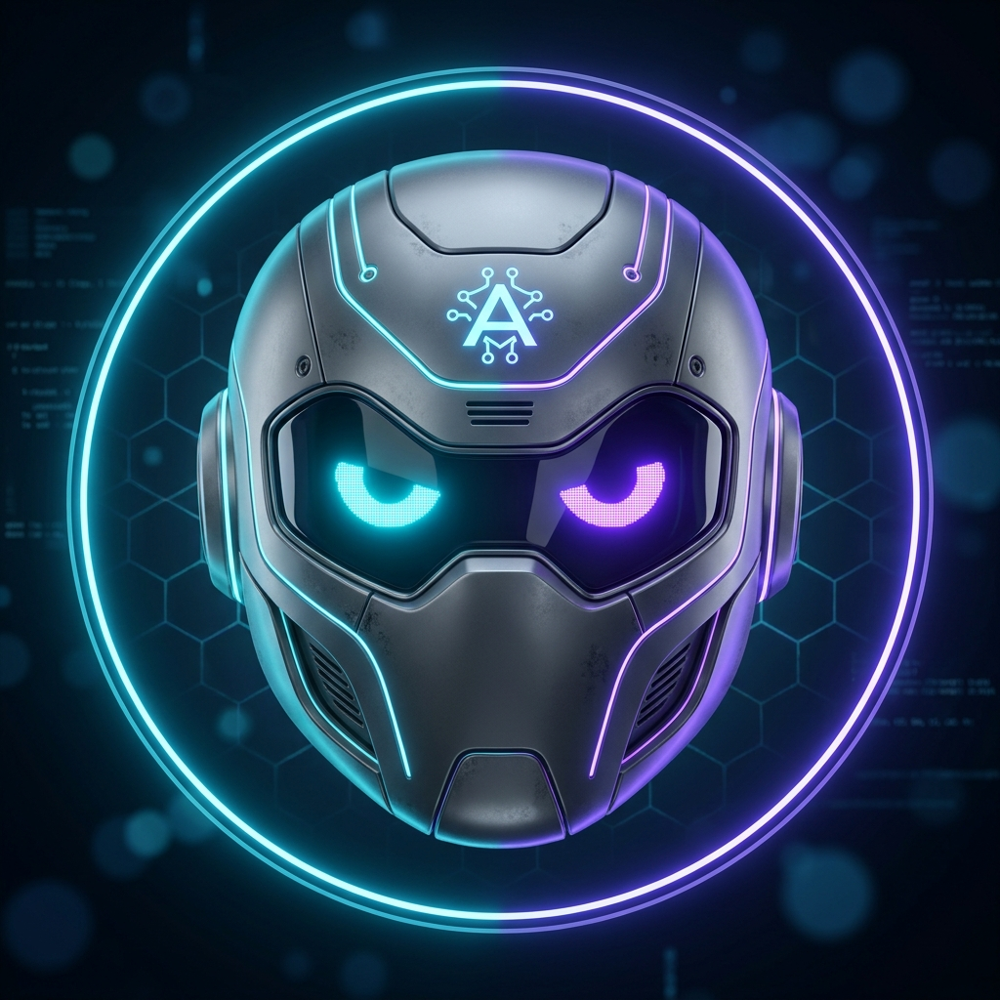
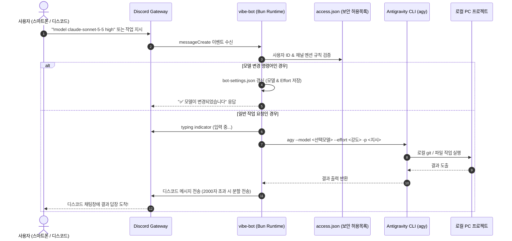

<p align="center">
  
</p>

<h1 align="center">⚡ vibe-bot: Antigravity Discord Agent Bridge</h1>

<p align="center">
  <b>스마트폰 및 외부 Discord 메신저로 내 컴퓨터의 Google Antigravity AI 에이전트를 원격 제어하는 양방향 브릿지 시스템</b>
</p>

<p align="center">
  
  
  
  
  
  
</p>

---

## 📖 프로젝트 개요

<p align="center">
  
</p>

`vibe-bot`은 집이나 사무실의 컴퓨터를 켜두고 외출했을 때, **스마트폰 디스코드 앱으로 내 PC의 AI 에이전트(Antigravity CLI)에게 코딩 작업이나 명령을 지시하고 실시간으로 결과를 돌려받을 수 있도록 연결해 주는 에이전틱 브릿지(Agentic Bridge)**입니다.

---

## ✨ 핵심 기능 (Features)

- 📱 **원격 코드 및 터미널 제어**: 어디서든 디스코드 채팅으로 `"git status 해줘"`, `"버그 찾아줘"`, `"테스트 돌려줘"` 등 실제 로컬 작업 실행
- 🔄 **실시간 동적 모델 및 강도 전환**:
  - 디스코드 채팅창에서 명령어(`!model`, `!models`, `!effort`)로 **Gemini, Claude, GPT 모델 및 추론 강도(low/medium/high)를 실시간 변경**
- 🔒 **화이트리스트 보안 제어 (`access.json`)**: 지정된 사용자 ID(본인)의 메시지만 처리하여 외부인의 무단 명령 원천 차단
- 📢 **스마트 멘션 라우팅**:
  - **전용 작업 채널**: 멘션(`@봇`) 없이 텍스트만 입력해도 자동 응답
  - **일반 서버 채널**: 다른 대화를 방해하지 않도록 `@vibe bot` 멘션 시에만 선택적 응답
  - **1:1 개인 메시지(DM)**: 멘션 없이 자유롭게 1:1 대화
- ⚡ **초고속 응답 & 경량화**: Zig 기반 초고속 **Bun 런타임** 구동으로 메모리 부담 최소화
- 💻 **어떤 PC에서도 무설치 호환**: 하드코딩된 절대 경로가 없어 깃허브 클론 후 더블클릭만으로 즉시 구동

---

## 🛠️ 기술 스택 (Tech Stack)

| 구분 | 기술 / 도구 | 용도 및 설명 |
| :--- | :--- | :--- |
| **Runtime** | **[Bun](https://bun.sh) (v1.4+)** | Node.js 대비 수배 빠른 초고속 TypeScript 실행 및 패키지 관리 |
| **Language** | **TypeScript** | 정적 타입을 통한 안정적인 이벤트 처리 및 모듈 개발 |
| **Discord API** | **[Discord.js](https://discord.js.org/) (v14)** | Gateway Intents 및 실시간 WebSocket 이벤트 송수신 |
| **AI Agent CLI**| **Google Antigravity CLI (`agy`)** | 파일 편집, 쉘 명령어 실행, 분석을 수행하는 로컬 AI 에이전트 |
| **Supported Models** | **Gemini 3.8 Flash, Gemini 4 Argon, Claude Sonnet/Opus 5.5, GPT-OSS 120B** | 채팅 명령어로 즉시 스위칭 가능한 멀티 모델 체계 |
| **Security** | **JSON Allowlist & `.env`** | 봇 토큰 보호 및 사용자/채널별 접근 권한 격리 |

---

## 🏛️ 시스템 구조도 (Architecture)



---

## 💬 지원 명령어 (Bot Commands)

디스코드 채팅창에서 봇에게 보낼 수 있는 주요 명령어입니다:

| 명령어 | 설명 | 예시 |
| :--- | :--- | :--- |
| **`!models`** / **`!모델목록`** | 사용 가능한 모델 및 강도(Effort) 목록을 조회합니다. | `!models` |
| **`!model`** / **`!모델`** | 현재 활성화되어 있는 모델과 추론 강도를 확인합니다. | `!model` |
| **`!model <모델명> [강도]`** | AI 모델과 추론 강도를 즉시 변경합니다. (설정 자동 저장) | `!model claude-sonnet-5-5 high`<br>`!model gemini-3.8-flash low` |
| **`!effort <low\|medium\|high>`** | 현재 모델의 추론 강도(Effort)만 변경합니다. | `!effort medium` |
| **`!help`** / **`!도움말`** | 봇 사용법 및 명령어 전체 안내를 확인합니다. | `!help` |
| **`!ping`** | 봇의 응답 상태 및 지연 시간을 점검합니다. | `!ping` |
| **`git status 해줘`** 등 일반 메시지 | 로컬 Antigravity 에이전트가 PC에서 실제 작업을 수행합니다. | `git status 해줘`<br>`최근 커밋 로그 3개 요약해줘` |

---

## 🚀 상세 설정 및 실행 가이드 (Step-by-Step)

### 1단계: 디스코드 봇 애플리케이션 생성
1. [Discord Developer Portal](https://discord.com/developers/applications)에 접속하여 **New Application** 클릭 (이름: `vibe-bot`)
2. **General Information**:
   - `assets/vibe_bot_icon.jpg`를 **APP ICON**으로 등록
   - `assets/vibe_bot_banner.jpg`를 **APP BANNER**로 등록
3. **Bot 탭**:
   - ⚠️ **`MESSAGE CONTENT INTENT` 토글을 반드시 ON으로 켜고 저장** (필수!)
   - **`Public Bot`**을 **OFF**로 변경 (외부 서버 초대 차단)
   - **`Reset Token`**을 눌러 봇 토큰 문자열 복사
4. **OAuth2 → URL Generator**:
   - **Scopes**: `bot` 체크
   - **Bot Permissions** (딱 6개만 체크):
     `View Channels`, `Send Messages`, `Send Messages in Threads`, `Read Message History`, `Attach Files`, `Add Reactions`
   - 생성된 URL을 브라우저에 열어 **내 디스코드 서버로 봇 초대**

---

### 2단계: 환경 설정 파일 준비

1. 저장소를 클론합니다:
   ```bash
   git clone https://github.com/hwnkue10-arch/vibe-bot.git
   cd vibe-bot
   ```
2. `.env.example`을 복사하여 `.env` 파일을 생성하고 봇 토큰을 입력합니다:
   ```env
   DISCORD_BOT_TOKEN=여기에_발급받은_디스코드_봇_토큰_입력
   ```
3. `access.json` 파일에 본인의 디스코드 사용자 ID와 전용 채널 ID를 설정합니다:
   ```json
   {
     "dmPolicy": "allowlist",
     "allowFrom": [
       "내_디스코드_숫자_ID"
     ],
     "groups": {
       "전용_채널_ID": {
         "requireMention": false,
         "allowFrom": ["내_디스코드_숫자_ID"]
       }
     },
     "pending": {}
   }
   ```
   > 💡 **사용자 ID 확인법**: 디스코드 설정 → 고급 → `개발자 모드` ON 후, 채팅창 내 프로필 우클릭 → `사용자 ID 복사`

---

### 3단계: 실행하기

의존성을 설치하고 봇을 실행합니다:

```powershell
# 의존성 설치
bun install

# 봇 실행
bun run bot.ts
```

> **Windows 사용자 팁**: 폴더에 있는 **`discord_bot.bat`** 파일을 더블클릭하면 모든 경로를 자동으로 설정하여 원클릭으로 봇이 켜집니다!

---

## 🔒 보안 주의사항 (Security)

- **`.env` 파일은 절대 커밋하지 마세요**: `.gitignore`에 등록되어 있어 실수로 올라가지 않도록 방지되어 있습니다.
- **토큰 재발급**: 공용 PC 등 외부 환경에서 작업한 후에는 디스코드 개발자 포털에서 `Reset Token`을 눌러 기존 토큰을 즉시 무효화하세요.
- **최소 권한 원칙**: 봇에 불필요한 관리자(`Administrator`) 권한을 부여하지 마세요.

---

## 📄 라이선스 (License)

This project is licensed under the MIT License.
